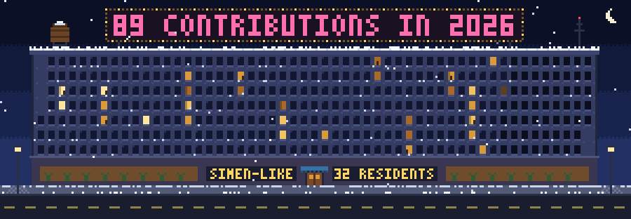
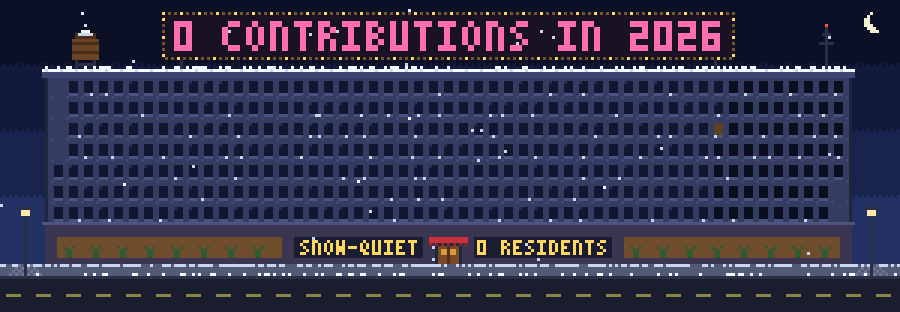
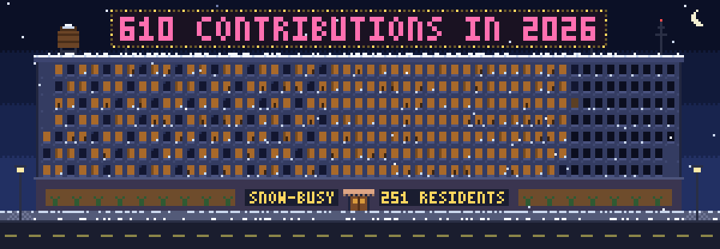

# git-apartments



git-apartments draws a pixel-art apartment building from a GitHub account's contributions this year. Every day from January 1 to December 31 is a window, laid out like the contribution graph: weeks run left to right and the days of the week are the floors. On a day you contributed, someone lives there and the light is on, brighter the more you did. Days still to come are empty, so the building fills up as the year goes on, and today's window blinks until you contribute. Your newest residents, from the last week's contributions, walk in off the snowy street carrying their boxes, and their windows light up as they reach their floor. A nightly workflow puts the building on a profile README as a looping GIF, the same tool runs from the command line, and the Rust library underneath is published on crates.io.

## What it shows

| Activity | Building |
| --- | --- |
| Each day of this year | One window: weeks across from January, Sunday on the top floor |
| Contributions that day | The light: dark when empty, then dim amber up to bright |
| Days still to come | Darker, empty windows |
| Today, before you contribute | A blinking window |
| Days with contributions in the last week (up to 3) | New residents walking in with boxes |
| Contributions so far this year | The neon sign on the roof |
| Days with contributions | The residents count by the door |
| Top languages | The new residents' coats and the awning |

With nobody moving in this week, someone just walks past. Ten days in a row light ten windows in a row, the same way they fill squares on GitHub: down a column from Sunday to Saturday, then on into the next week. On January 1 the building starts over, empty, for the new year.





## Repository structure

```
.
├── .github/      workflows, issue forms, and Dependabot
├── docs/         the getting-started guide and the gallery
├── examples/     the profile workflow and the gallery generator
├── src/          the library and the git-apartments command
├── tests/        the public-boundary tests and their fixtures
└── action.yml    the GitHub Action
```

## Usage

### Requirements

- For a building on your profile README: a GitHub account. The Action runs in your profile repository's workflow with its built-in token.
- For the command line: a binary from the [releases page](https://github.com/SimenVangen/git-apartments/releases), or Rust at or above the `rust-version` in [Cargo.toml](Cargo.toml), plus the [GitHub CLI](https://cli.github.com/), authenticated.
- For the library: Rust at or above that same version.

[docs/getting-started.md](docs/getting-started.md) walks through all three. The API is documented on [docs.rs](https://docs.rs/git-apartments).

### Quick start

In your profile repository, add [`examples/profile-workflow.yml`](examples/profile-workflow.yml) as `.github/workflows/apartments.yml`, put this in `README.md`, and run the workflow once from the Actions tab:

```markdown

```

## Author

- Email: [simenv@hotmail.no](mailto:simenv@hotmail.no)
- GitHub: [@SimenVangen](https://github.com/SimenVangen)

## License

MIT. See [LICENSE](LICENSE).
